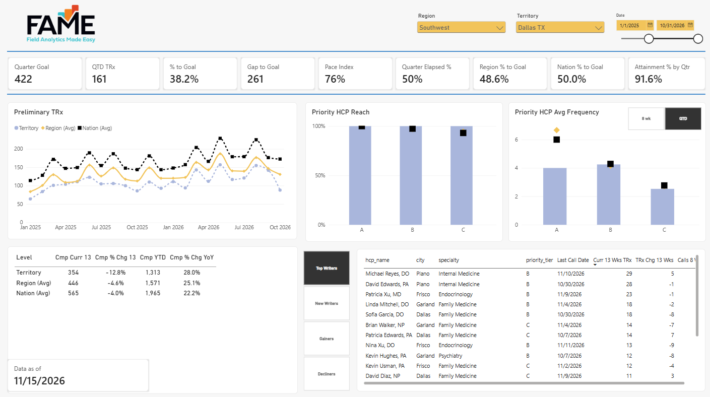
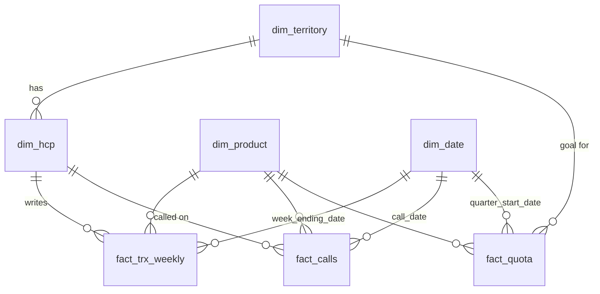

# Pharma Field Sales Dashboard

A commercial analytics dashboard for a pharma field sales team, built twice from the same synthetic data:

- **Power BI** report on a PostgreSQL-backed star schema (`powerbi/`, `sql/`, `dax/`)
- **Interactive web version** (`web/`) that runs in any browser and deploys to Vercel as a static site



**Live demo:** _add your Vercel URL here_ &nbsp;|&nbsp; **Portfolio:** https://anthony.microversesoln.com/

> All data is synthetic. The products (Neurovia, Cardiolex), HCPs, reps and territories are fictional.

## What it answers

| Question a rep or manager asks | Where it shows |
|---|---|
| How is my territory trending against my region and the nation? | Preliminary TRx line, comparison table (13-week, YTD, YoY) |
| Am I on pace to hit this quarter's goal? | Goal cards: quarter goal, QTD TRx, % to goal, gap, pace index, quarter elapsed |
| Am I reaching my priority HCPs, and how often? | Priority HCP Reach and Avg. Frequency by tier (A/B/C), 8-week or QTD |
| Who do I act on? | HCP table: New Writers, Top Writers, Gainers, Decliners (13-week TRx change) |

Filters: Region, Territory, Product, and a date range for the trend line.

## Data model



| Table | Grain | Rows |
|---|---|---|
| `dim_date` | day, 2024-01-01 to 2026-11-15 | 1,050 |
| `dim_territory` | territory (30 territories, 5 regions) | 30 |
| `dim_hcp` | prescriber, with specialty, city, priority tier (A, B, C, NP) | 1,963 |
| `dim_product`, `dim_rep` | product, rep | 2, 30 |
| `fact_trx_weekly` | HCP x product x week-ending date (zero weeks not stored; Final vs Preliminary flag) | 106,861 |
| `fact_calls` | one row per call | 88,279 |
| `fact_quota` | territory x product x quarter TRx goal | 720 |
| `data_refresh` | freshness dates for the footer | 3 |

## Metric definitions

- **Windows** are anchored to the latest week (11/15/2026). *Curr 13 Wks* = the last 13 week-ending dates; *Prior 13 Wks* = the 13 before. YTD and last-year YTD use week-ending dates from Jan 1 through the latest week and the same date a year earlier.
- **Region (Avg) / Nation (Avg)** = total TRx divided by the number of territories in the region / nation, so a territory is compared with a typical territory.
- **New writer** = TRx in the current 13 weeks and none in any earlier week.
- **Top Writers / Gainers / Decliners** show the top 10 by current TRx or by 13-week change (ties share a rank, so a view can show slightly more than 10 rows).
- **Reach** = priority HCPs called at least once in the window / priority HCPs. **Avg. frequency** = calls / reached HCPs. Window is 8 weeks or quarter-to-date. Region and Nation markers are pooled across all priority HCPs.
- **Goal attainment** = QTD TRx / full-quarter goal. **Pace index** = % to goal / share of the quarter elapsed (100% or more is on pace).

## Run it

### 1. Load the data into PostgreSQL
Requires PostgreSQL and `psql`. Run from the repo root:
```bash
psql -U postgres -h localhost -c "CREATE DATABASE pharma_db;"
psql -U postgres -h localhost -d pharma_db -f sql/01_schema_and_load.sql
psql -U postgres -h localhost -d pharma_db -f sql/02_add_quota.sql
```
Tables are created in a `pharma` schema. `vw_hcp_13wk_check` is a SQL cross-check of the 13-week writer logic.

### 2. Power BI
1. Open `powerbi/pharma_sales_dashboard.pbix`, or rebuild: Get Data > PostgreSQL (`localhost`, `pharma_db`), Import mode, load the `pharma` tables.
2. Rename tables to drop the `pharma` prefix and turn off *Auto date/time* (File > Options > Current File > Data Load).
3. Relationships (one-to-many, single direction): see the data model above. Mark `dim_date` as the date table on `date_key`.
4. Create the helper tables listed at the top of `dax/measures.dax.txt`.
5. In **TMDL view**, paste `dax/measures.tmdl` and click Apply. `dax/measures.dax.txt` has the same measures in readable form.

### 3. Web version
```bash
cd web
python -m http.server 8000   # then open http://localhost:8000
```
`web/data.json` is built from the CSVs by `scripts/build_web_data.py`. To regenerate everything: `python scripts/generate_sample_data.py`, `python scripts/generate_quota.py`, then `python scripts/build_web_data.py` (needs pandas and numpy; the data is seeded, so output is reproducible).

### 4. Deploy to Vercel
Import the repo in Vercel, set **Root Directory** to `web`, framework **Other**, no build command.

## Repo layout
```
data/         CSV extracts (generated, synthetic)
sql/          Postgres schema, loads, validation view
dax/          final measures (TMDL + readable)
powerbi/      Power BI report (.pbix)
web/          static web dashboard (index.html, model.js, data.json, vendor/)
scripts/      data generation and web-data build
screenshots/  dashboard images
```

## Validation
The web version's calculations were checked against the Power BI measures and against independent calculations from the CSVs for several selections (all territories, Boston MA, Dallas TX; 8-week and QTD windows; all four writer views). They match.

## Notes
Built with Power BI Desktop, PostgreSQL, DAX/TMDL, Python (pandas), vanilla JavaScript and Chart.js 4.4.7 (bundled in `web/vendor`).

Author: Anthony Gatchalian
